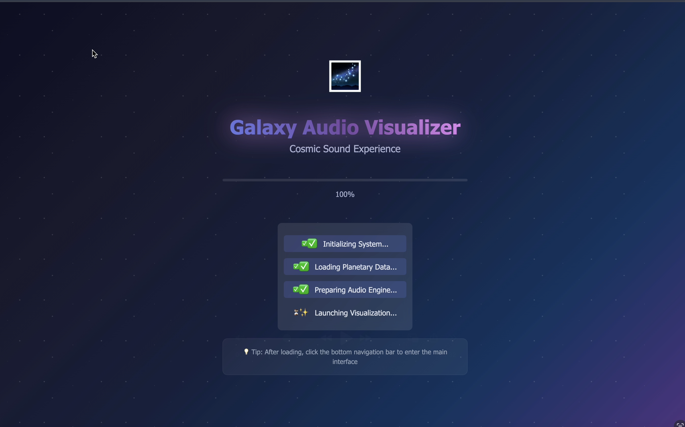

**English** | [简体中文](README.zh-CN.md)

# 🌌 Galaxy Audio Visualizer Player

[](https://opensource.org/licenses/MIT)
[](https://developer.mozilla.org/en-US/docs/Web/JavaScript)
[](https://p5js.org/)
[](https://developer.mozilla.org/en-US/docs/Web/API/Web_Audio_API)

> A professional audio visualization player built with modern web technologies, featuring real-time audio analysis, multiple visualization modes, and a stunning cosmic-themed interface.

## 🎵 Live Demo

**[🚀 Try it now!](https://leechuihui.github.io/programing2-final-exam-report-galaxy-audio-visualizer/)**

## 🎥 Demo Video

<div align="center">

### 🎬 Watch the Demo Video

[](https://github.com/user-attachments/assets/d1085ca0-4b17-4271-8a93-dbb14d3464cc)

**⬇️ Click the image above to watch the demonstration ⬆️**

---

### 📺 Quick Access Links

| 🎯 Action | 🔗 Link |
|-----------|---------|
| **📹 Watch Video (GitHub)** | [GitHub Video Link](https://github.com/user-attachments/assets/d1085ca0-4b17-4271-8a93-dbb14d3464cc) |
| **📹 Local Video** | [media/demo-videos/demo1.mov](media/demo-videos/demo1.mov) |
| **📁 Video Directory** | [media/demo-videos/](media/demo-videos/) |
| **📖 Viewing Guide** | [WATCH_VIDEO_GUIDE.md](WATCH_VIDEO_GUIDE.md) |

</div>

*Watch the Galaxy Audio Visualizer Player in action*

### 🎬 Video Content
- **Duration**: Short demonstration video
- **Size**: 9.8MB (local) / GitHub hosted
- **Format**: MOV / MP4 (GitHub optimized)
- **Content**: Project overview showing solar system visualization, advanced controls, and audio processing features

### 📺 Alternative Viewing Options
- [📺 **GitHub Video Link**](https://github.com/user-attachments/assets/d1085ca0-4b17-4271-8a93-dbb14d3464cc) - **Primary video (recommended)**
- [📺 **Local Video File**](media/demo-videos/demo1.mov) - Download and play locally
- [📋 **Video Recording Guide**](VIDEO_RECORDING_GUIDE.md) - Learn how to create your own demo
- [📖 **Watching Guide**](WATCH_VIDEO_GUIDE.md) - Detailed viewing instructions


## 📸 Screenshots

<div align="center">
  

</div>

<div align="center">

  
</div>
<div align="center">

  

</div>

> **Note**: Screenshots coming soon! Follow the [Screenshot Guide](media/screenshots/README.md) to capture and upload your own screenshots.

## ✨ Features

### 🎨 Visualization Modes
- **🌌 Particle System**: Dynamic particle network with music-responsive animations
- **📊 Spectrum Analysis**: Real-time frequency analysis with multi-band visualization
- **🌊 Waveform Display**: Time-domain signal analysis with dynamic amplitude
- **💓 Needle Charts**: ECG-style heart monitor display with audio energy mapping

### 🎛️ Audio Processing
- **🎚️ Professional Equalizer**: 10-band precise control (32Hz-16kHz)
- **🎵 Preset Modes**: Bass boost, treble boost, vocal enhancement
- **📈 Real-time Analysis**: Spectrum analysis, audio stats, dynamic range detection
- **⚡ Advanced Controls**: Playback speed, fade effects, reverb processing

### 🖥️ User Interface
- **📱 Responsive Design**: Optimized for desktop, tablet, and mobile
- **✨ Modern UI**: Glassmorphism effects, gradient colors, smooth transitions
- **🎮 Smart Navigation**: Bottom navigation bar, left info sidebar, floating controls
- **⌨️ Keyboard Shortcuts**: Full keyboard control support

### 🎵 Audio Features
- **🔄 Dynamic Playlist**: Auto-detects MP3 files in assets folder
- **🎧 Multi-format Support**: MP3, WAV, and other popular formats
- **🔊 Volume Control**: Real-time adjustment with visual indicators
- **🔄 Playback Modes**: Loop list, loop single, shuffle

## 🚀 Quick Start

### Prerequisites
- Modern web browser (Chrome, Firefox, Safari, Edge)
- Node.js (v14+) for development
- Local web server (for audio file access)

### Installation

1. **Clone the repository**
   ```bash
   git clone https://github.com/Leechuihui/programing2-final-exam-report-galaxy-audio-visualizer.git
   cd programing2-final-exam-report-galaxy-audio-visualizer
   ```

2. **Add your audio files**
   ```bash
   # Place your MP3 files in the assets/ folder
   cp your-music/*.mp3 assets/
   ```

3. **Generate audio configuration**
   ```bash
   node scan-audio-files.js
   ```

4. **Start local server**
   ```bash
   # Using Python
   python -m http.server 8000

   # Using Node.js
   npx serve .

   # Using PHP
   php -S localhost:8000
   ```

5. **Open in browser**
   ```
   http://localhost:8000
   ```

## 🎮 Controls

### Keyboard Shortcuts
- **Spacebar**: Play/Pause
- **←/→**: Previous/Next song
- **M**: Mute/Unmute
- **L**: Cycle playback modes
- **R**: Reload audio files
- **F11**: Fullscreen mode

### Mouse/Touch Controls
- **Click play button**: Play/Pause
- **Click progress bar**: Jump to position
- **Drag volume slider**: Adjust volume
- **Click mode buttons**: Switch visualization modes

## 🏗️ Technical Architecture

### Tech Stack
- **Frontend**: HTML5, CSS3, JavaScript ES6+
- **Graphics**: p5.js for creative coding and Canvas 2D rendering
- **Audio**: p5.sound.js and Web Audio API
- **Build**: Vanilla JavaScript (no build process required)

### Core Components
```
src/
├── index.html              # Main application entry point
├── sketch.js               # Core visualization engine
├── needles.js              # Needle chart visualization
├── plant.js                # Planet system data
├── scan-audio-files.js     # Audio file scanner
└── assets/                 # Audio files directory
    ├── *.mp3              # Audio files
    └── audio-files.json   # Auto-generated config
```

### Architecture Pattern
- **Modular Design**: Independent functional modules
- **MVC Architecture**: Clear separation of data, view, and control
- **Event-driven**: Responsive user interactions
- **State Management**: Centralized application state

## 🎨 Customization

### Adding New Visualization Modes
```javascript
// In sketch.js, add your custom mode
const CUSTOM_MODE = 4;

function drawCustomVisualization() {
    // Your visualization logic here
    background(0, 0, 20);
    // ... custom drawing code
}
```

### Modifying Audio Processing
```javascript
// In sketch.js, customize audio analysis
function analyzeAudio() {
    // Your custom audio analysis
    const customData = fft.analyze();
    // ... process custom data
}
```

### Styling Customization
```css
/* In index.html, modify CSS variables */
:root {
    --primary-color: #667eea;
    --secondary-color: #764ba2;
    --accent-color: #f093fb;
}
```

## 📱 Browser Compatibility

| Browser | Version | Support |
|---------|---------|---------|
| Chrome | 60+ | ✅ Full |
| Firefox | 55+ | ✅ Full |
| Safari | 12+ | ✅ Full |
| Edge | 79+ | ✅ Full |
| Mobile Safari | 12+ | ✅ Full |
| Chrome Mobile | 60+ | ✅ Full |

## 🧪 Development

### Project Structure
```
galaxy-audio-visualizer/
├── README.md                    # This file
├── LICENSE                      # MIT License
├── CONTRIBUTING.md              # Contribution guidelines
├── index.html                   # Main application
├── sketch.js                    # Core visualization engine
├── needles.js                   # Needle chart component
├── plant.js                     # Planet system data
├── scan-audio-files.js          # Audio file scanner
├── audio-files.json             # Auto-generated config
├── assets/                      # Audio files
├── docs/                        # Documentation
│   ├── DYNAMIC_PLAYLIST_README.md
│   └── KEYBOARD_SHORTCUTS.md
└── .github/                     # GitHub configurations
    └── workflows/
        └── deploy.yml
```

### Development Setup
```bash
# Install dependencies (if any)
npm install

# Start development server
npm run dev

# Build for production
npm run build

# Run tests
npm test
```

### Code Style
- Use ES6+ features
- Follow JavaScript Standard Style
- Comment complex algorithms
- Use meaningful variable names

## 🤝 Contributing

We welcome contributions! Please see our [Contributing Guidelines](CONTRIBUTING.md) for details.

### How to Contribute
1. Fork the repository
2. Create a feature branch (`git checkout -b feature/amazing-feature`)
3. Commit your changes (`git commit -m 'Add amazing feature'`)
4. Push to the branch (`git push origin feature/amazing-feature`)
5. Open a Pull Request

### Development Guidelines
- Write clean, readable code
- Add comments for complex logic
- Test on multiple browsers
- Update documentation as needed

## 📊 Performance

### Optimization Features
- **60 FPS Rendering**: Stable frame rate with performance monitoring
- **Memory Management**: Efficient object pooling and garbage collection
- **Audio Latency**: <50ms processing delay
- **Responsive Design**: Optimized for all screen sizes

### Performance Metrics
- **Initial Load**: <2 seconds
- **Memory Usage**: <100MB typical
- **CPU Usage**: <30% on modern devices
- **Battery Impact**: Optimized for mobile devices

## 🐛 Troubleshooting

### Common Issues

**Audio files not loading**
```bash
# Check file permissions
ls -la assets/
# Regenerate configuration
node scan-audio-files.js
```

**Visualization not working**
- Check browser console for errors
- Ensure Web Audio API is supported
- Try refreshing the page

**Performance issues**
- Reduce particle count in settings
- Close other browser tabs
- Check system resources

### Getting Help
- Check the [Issues](https://github.com/Leechuihui/programing2-final-exam-report-galaxy-audio-visualizer/issues) page
- Create a new issue with detailed information
- Include browser version and error messages

## 📈 Roadmap

### Upcoming Features
- [ ] **3D Visualization**: WebGL-powered 3D effects
- [ ] **AI Audio Analysis**: Smart music classification
- [ ] **Social Features**: Sharing and collaboration
- [ ] **Plugin System**: Third-party extensions
- [ ] **PWA Support**: Offline usage and installation
- [ ] **VR/AR Support**: Immersive audio experiences

### Version History
- **v1.0.0** - Initial release with core features
- **v1.1.0** - Added dynamic playlist system
- **v1.2.0** - Enhanced mobile support
- **v2.0.0** - Major UI overhaul and performance improvements

## 📄 License

This project is licensed under the MIT License - see the [LICENSE](LICENSE) file for details.

## 🙏 Acknowledgments

- **p5.js Community** for the amazing creative coding library
- **Web Audio API** for professional audio processing capabilities
- **Contributors** who helped improve this project
- **Open Source Community** for inspiration and support

## 📞 Contact


- **Email**: lizhuhui999@gmail.com
- **Project Link**: [https://github.com/Leechuihui/programing2-final-exam-report-galaxy-audio-visualizer](https://github.com/Leechuihui/programing2-final-exam-report-galaxy-audio-visualizer)

## ⭐ Show Your Support

Give a ⭐️ if this project helped you!

---

<div align="center">
  <p>Made with ❤️ and lots of ☕</p>
  <p>© 2025 Galaxy Audio Visualizer Player</p>
</div>
