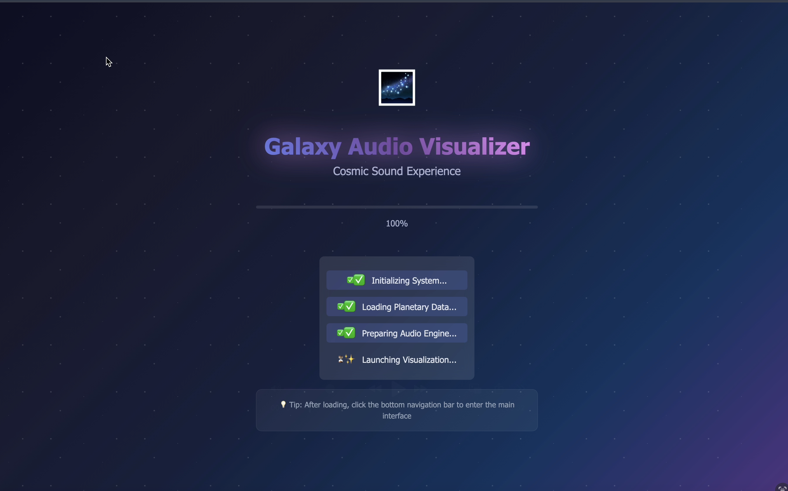

[English](README.md) | **简体中文**

# 🌌 星系音频可视化播放器

[](https://opensource.org/licenses/MIT)
[](https://developer.mozilla.org/en-US/docs/Web/JavaScript)
[](https://p5js.org/)
[](https://developer.mozilla.org/en-US/docs/Web/API/Web_Audio_API)

> 一个使用现代 Web 技术构建的专业音频可视化播放器，具备实时音频分析、多种可视化模式以及绚丽的宇宙主题界面。

## 🎵 在线演示

**[🚀 立即体验！](https://leechuihui.github.io/programing2-final-exam-report-galaxy-audio-visualizer/)**

## 🎥 演示视频

<div align="center">

### 🎬 观看演示视频

[](https://github.com/user-attachments/assets/d1085ca0-4b17-4271-8a93-dbb14d3464cc)

**⬇️ 点击上方图片观看演示 ⬆️**

---

### 📺 快速访问链接

| 🎯 操作 | 🔗 链接 |
|-----------|---------|
| **📹 观看视频（GitHub）** | [GitHub 视频链接](https://github.com/user-attachments/assets/d1085ca0-4b17-4271-8a93-dbb14d3464cc) |
| **📹 本地视频** | [media/demo-videos/demo1.mov](media/demo-videos/demo1.mov) |
| **📁 视频目录** | [media/demo-videos/](media/demo-videos/) |
| **📖 观看指南** | [WATCH_VIDEO_GUIDE.md](WATCH_VIDEO_GUIDE.md) |

</div>

*观看星系音频可视化播放器的实际运行效果*

### 🎬 视频内容
- **时长**：短演示视频
- **大小**：9.8MB（本地）/ GitHub 托管
- **格式**：MOV / MP4（GitHub 优化）
- **内容**：项目概览，展示太阳系可视化、高级控件与音频处理功能

### 📺 其他观看方式
- [📺 **GitHub 视频链接**](https://github.com/user-attachments/assets/d1085ca0-4b17-4271-8a93-dbb14d3464cc) - **首选视频（推荐）**
- [📺 **本地视频文件**](media/demo-videos/demo1.mov) - 下载后本地播放
- [📋 **视频录制指南**](VIDEO_RECORDING_GUIDE.md) - 学习如何制作你自己的演示视频
- [📖 **观看指南**](WATCH_VIDEO_GUIDE.md) - 详细的观看说明


## 📸 截图

<div align="center">
  

</div>

<div align="center">

  
</div>
<div align="center">

  

</div>

> **注意**：截图即将上线！请按照[截图指南](media/screenshots/README.md)拍摄并上传你自己的截图。

## ✨ 功能特性

### 🎨 可视化模式
- **🌌 粒子系统**：动态粒子网络，伴随随音乐响应的动画效果
- **📊 频谱分析**：实时频率分析与多频段可视化
- **🌊 波形显示**：时域信号分析，动态振幅展示
- **💓 指针图表**：心电图式的心率监护仪显示，映射音频能量

### 🎛️ 音频处理
- **🎚️ 专业均衡器**：10 频段精确控制（32Hz-16kHz）
- **🎵 预设模式**：低音增强、高音增强、人声增强
- **📈 实时分析**：频谱分析、音频统计、动态范围检测
- **⚡ 高级控制**：播放速度、淡入淡出效果、混响处理

### 🖥️ 用户界面
- **📱 响应式设计**：针对桌面、平板和移动端优化
- **✨ 现代化 UI**：毛玻璃效果、渐变配色、平滑过渡
- **🎮 智能导航**：底部导航栏、左侧信息栏、浮动控件
- **⌨️ 键盘快捷键**：完整的键盘控制支持

### 🎵 音频功能
- **🔄 动态播放列表**：自动检测 assets 目录中的 MP3 文件
- **🎧 多格式支持**：MP3、WAV 及其他常见格式
- **🔊 音量控制**：实时调节，带可视化指示
- **🔄 播放模式**：列表循环、单曲循环、随机播放

## 🚀 快速开始

### 前置要求
- 现代浏览器（Chrome、Firefox、Safari、Edge）
- Node.js（v14+）用于开发
- 本地 Web 服务器（用于访问音频文件）

### 安装

1. **克隆仓库**
   ```bash
   git clone https://github.com/Leechuihui/programing2-final-exam-report-galaxy-audio-visualizer.git
   cd programing2-final-exam-report-galaxy-audio-visualizer
   ```

2. **添加你的音频文件**
   ```bash
   # 将你的 MP3 文件放入 assets/ 目录
   cp your-music/*.mp3 assets/
   ```

3. **生成音频配置**
   ```bash
   node scan-audio-files.js
   ```

4. **启动本地服务器**
   ```bash
   # 使用 Python
   python -m http.server 8000

   # 使用 Node.js
   npx serve .

   # 使用 PHP
   php -S localhost:8000
   ```

5. **在浏览器中打开**
   ```
   http://localhost:8000
   ```

## 🎮 操作控制

### 键盘快捷键
- **空格键**：播放/暂停
- **←/→**：上一首/下一首
- **M**：静音/取消静音
- **L**：切换播放模式
- **R**：重新加载音频文件
- **F11**：全屏模式

### 鼠标/触屏控制
- **点击播放按钮**：播放/暂停
- **点击进度条**：跳转到指定位置
- **拖动音量滑块**：调节音量
- **点击模式按钮**：切换可视化模式

## 🏗️ 技术架构

### 技术栈
- **前端**：HTML5、CSS3、JavaScript ES6+
- **图形**：p5.js 创意编程与 Canvas 2D 渲染
- **音频**：p5.sound.js 与 Web Audio API
- **构建**：原生 JavaScript（无需构建流程）

### 核心组件
```
src/
├── index.html              # 主应用入口
├── sketch.js               # 核心可视化引擎
├── needles.js              # 指针图表可视化
├── plant.js                # 星球系统数据
├── scan-audio-files.js     # 音频文件扫描器
└── assets/                 # 音频文件目录
    ├── *.mp3              # 音频文件
    └── audio-files.json   # 自动生成的配置
```

### 架构模式
- **模块化设计**：功能模块相互独立
- **MVC 架构**：数据、视图与控制清晰分离
- **事件驱动**：灵敏的用户交互
- **状态管理**：集中式应用状态

## 🎨 自定义

### 添加新的可视化模式
```javascript
// 在 sketch.js 中，添加你的自定义模式
const CUSTOM_MODE = 4;

function drawCustomVisualization() {
    // 你的可视化逻辑
    background(0, 0, 20);
    // ... 自定义绘制代码
}
```

### 修改音频处理
```javascript
// 在 sketch.js 中，自定义音频分析
function analyzeAudio() {
    // 你的自定义音频分析
    const customData = fft.analyze();
    // ... 处理自定义数据
}
```

### 样式自定义
```css
/* 在 index.html 中，修改 CSS 变量 */
:root {
    --primary-color: #667eea;
    --secondary-color: #764ba2;
    --accent-color: #f093fb;
}
```

## 📱 浏览器兼容性

| 浏览器 | 版本 | 支持情况 |
|---------|---------|---------|
| Chrome | 60+ | ✅ 完全支持 |
| Firefox | 55+ | ✅ 完全支持 |
| Safari | 12+ | ✅ 完全支持 |
| Edge | 79+ | ✅ 完全支持 |
| 移动版 Safari | 12+ | ✅ 完全支持 |
| 移动版 Chrome | 60+ | ✅ 完全支持 |

## 🧪 开发

### 项目结构
```
galaxy-audio-visualizer/
├── README.md                    # 本文件
├── LICENSE                      # MIT 许可证
├── CONTRIBUTING.md              # 贡献指南
├── index.html                   # 主应用
├── sketch.js                    # 核心可视化引擎
├── needles.js                   # 指针图表组件
├── plant.js                     # 星球系统数据
├── scan-audio-files.js          # 音频文件扫描器
├── audio-files.json             # 自动生成的配置
├── assets/                      # 音频文件
├── docs/                        # 文档
│   ├── DYNAMIC_PLAYLIST_README.md
│   └── KEYBOARD_SHORTCUTS.md
└── .github/                     # GitHub 配置
    └── workflows/
        └── deploy.yml
```

### 开发环境搭建
```bash
# 安装依赖（如有）
npm install

# 启动开发服务器
npm run dev

# 构建生产版本
npm run build

# 运行测试
npm test
```

### 代码风格
- 使用 ES6+ 特性
- 遵循 JavaScript Standard Style
- 为复杂算法添加注释
- 使用有意义的变量名

## 🤝 参与贡献

欢迎贡献！详情请参阅我们的[贡献指南](CONTRIBUTING.md)。

### 如何贡献
1. Fork 本仓库
2. 创建功能分支（`git checkout -b feature/amazing-feature`）
3. 提交更改（`git commit -m 'Add amazing feature'`）
4. 推送到分支（`git push origin feature/amazing-feature`）
5. 发起 Pull Request

### 开发准则
- 编写整洁、易读的代码
- 为复杂逻辑添加注释
- 在多种浏览器上测试
- 按需更新文档

## 📊 性能

### 优化特性
- **60 FPS 渲染**：帧率稳定，带性能监控
- **内存管理**：高效的对象池与垃圾回收
- **音频延迟**：处理延迟 <50ms
- **响应式设计**：针对所有屏幕尺寸优化

### 性能指标
- **首次加载**：<2 秒
- **内存占用**：通常 <100MB
- **CPU 占用**：现代设备上 <30%
- **电池影响**：针对移动设备优化

## 🐛 故障排除

### 常见问题

**音频文件无法加载**
```bash
# 检查文件权限
ls -la assets/
# 重新生成配置
node scan-audio-files.js
```

**可视化不工作**
- 检查浏览器控制台的错误信息
- 确认浏览器支持 Web Audio API
- 尝试刷新页面

**性能问题**
- 在设置中减少粒子数量
- 关闭其他浏览器标签页
- 检查系统资源

### 获取帮助
- 查看 [Issues](https://github.com/Leechuihui/programing2-final-exam-report-galaxy-audio-visualizer/issues) 页面
- 提交新 Issue 并附上详细信息
- 提供浏览器版本与错误信息

## 📈 路线图

### 计划中的功能
- [ ] **3D 可视化**：基于 WebGL 的 3D 效果
- [ ] **AI 音频分析**：智能音乐分类
- [ ] **社交功能**：分享与协作
- [ ] **插件系统**：第三方扩展
- [ ] **PWA 支持**：离线使用与安装
- [ ] **VR/AR 支持**：沉浸式音频体验

### 版本历史
- **v1.0.0** - 首个发布版本，包含核心功能
- **v1.1.0** - 新增动态播放列表系统
- **v1.2.0** - 增强移动端支持
- **v2.0.0** - 界面大改版与性能提升

## 📄 许可证

本项目基于 MIT 许可证发布 - 详情请参阅 [LICENSE](LICENSE) 文件。

## 🙏 致谢

- **p5.js 社区** — 感谢出色的创意编程库
- **Web Audio API** — 提供专业的音频处理能力
- **贡献者** — 帮助改进本项目的人们
- **开源社区** — 感谢灵感与支持

## 📞 联系方式


- **邮箱**：lizhuhui999@gmail.com
- **项目链接**：[https://github.com/Leechuihui/programing2-final-exam-report-galaxy-audio-visualizer](https://github.com/Leechuihui/programing2-final-exam-report-galaxy-audio-visualizer)

## ⭐ 支持一下

如果本项目对你有帮助，请给一个 ⭐️！

---

<div align="center">
  <p>用 ❤️ 和大量 ☕ 铸就</p>
  <p>© 2025 星系音频可视化播放器</p>
</div>
